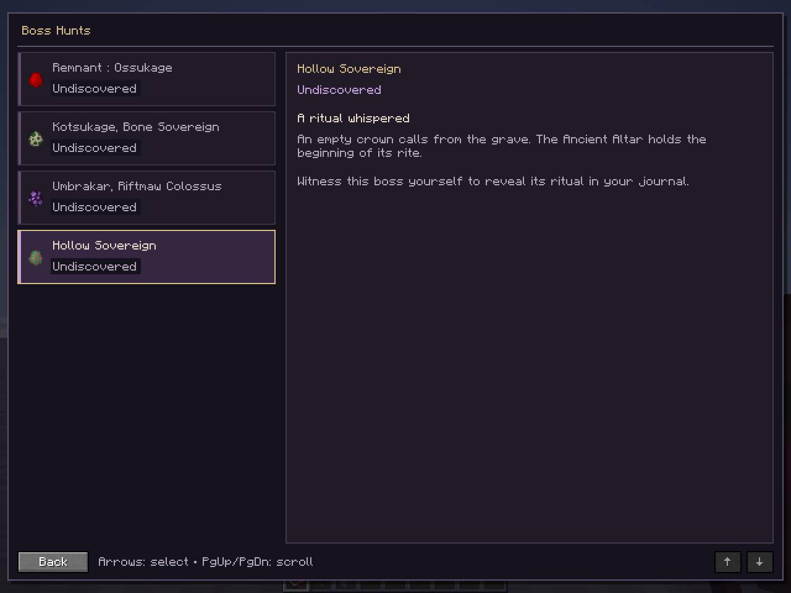
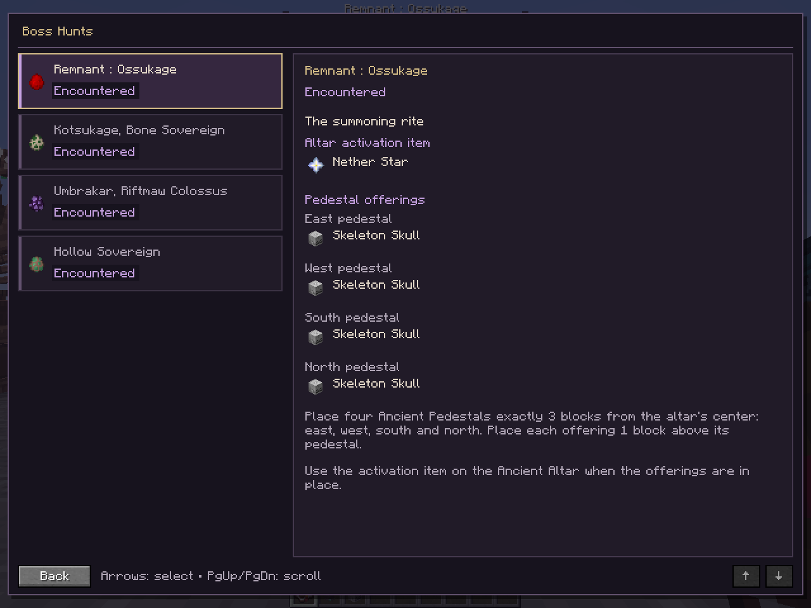
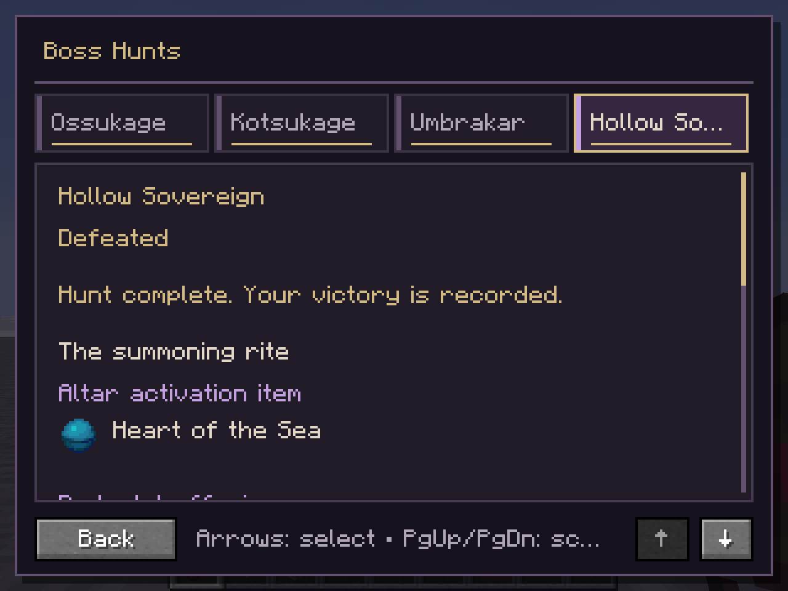

# Boss Hunts 2.7.0 test report

Recorded 2026-10-12. Based on latest GitHub `main`, `3a47ea949e71deef157c47ab88cf8c0c5a44b6e2`; fetched again before preparing the draft PR. Implementation branch: `codex/boss-hunts`. This is an unreleased update; optional rewards are deferred.

## Versions

| Minecraft | Loader | Game Java | GeckoLib | JAuml | Build result |
| --- | --- | --- | --- | --- | --- |
| 1.20.1 | Fabric 0.16.9 | 17.0.20.1 and 21.0.12.1 tested | 4.4.9 | 2.1.1 | PASS |
| 1.20.1 | Forge 47.4.20 | 17.0.20.1 | 4.4.9 | 2.1.1 | PASS |
| 1.21.1 | Fabric 0.19.3 | 21.0.12.1 | 4.8.4 | 2.1.1 | PASS |
| 1.21.1 | NeoForge 21.1.219 | 21.0.12.1 | 4.8.4 | 2.1.1 | PASS |

Temurin JDKs; Windows 11. Gradle 8.11 for the aggregator/1.20.1, Gradle 8.10 for 1.21.1, Node 24.21.0, Python 3.12.10. Effective Fabric API versions reported by the actual runtimes were **0.92.2+1.20.1** and **0.116.6+1.21.1**, rather than the lower declared dependency versions.

## Passed automated checks

- `1.20.1\gradlew.bat -p . buildAll --console=plain` with Gradle running on Java 21: both complete workspace builds, all four loader jars collected. Final production sources built successfully.
- Both `:common:verifyCrafting` tasks ran in the full builds: native Minecraft recipe parsers and crafting matchers accept the recipes, reject wrong altar/pedestal ingredients, and validate block loot. The new journal recipe parses. Existing tests substitute vanilla items for mod IDs; they do not establish an actual crafting interaction.
- Both `:common:verifyJournal` tasks: actual NBT save/load, monotonic/idempotent state, dirty-state suppression, unknown/future/malformed schema preservation, canonical IDs, cancelled-death guards, accepted-damage accounting, discovery sight/radius/dimension/spectator rules, contribution time/distance/dimension/logout boundaries, bounded maps and request version/cooldown checks.
- Added exact-set fixtures for two contributors and a nearby uninvolved third player, independent contributor expiry and an ineligible first contributor. Java 17/21 policy runs passed; a disposable mutation that credited only the first contributor failed the fixture. These are policy tests, not three connected Minecraft clients.
- Reentrant health-write fixtures cover nested accepted pre-event damage followed by cancelled outer damage, nested zero-damage post-events, nested loss exclusion, healing and non-finite values. These accounting tests are separate from a real Forge/NeoForge event test.
- Real `FriendlyByteBuf` codec fixtures cover round-trip, truncation, excessive entries/strings/offerings, duplicate/unknown boss IDs, invalid states/schema and trailing client identity data.
- Actual vanilla registry fixtures reject null, malformed, unknown, oversized, air and unqualified activation values; offering order remains east/west/south/north. Layout fixtures cover multiple GUI sizes, list/detail/footer bounds and scroll clamping.
- `node --test scripts/recipes.test.mjs scripts/upload_platforms.test.mjs`: **14 passed, 0 failed**. These use test transports; nothing was published.
- `python scripts/verify_release_jars.py --version 2.7.0 --output docs/boss-hunts-artifacts.json`: all four package/metadata/resource audits pass. Additional ZIP inspection confirms journal classes and the common mixin exist, with no runtime probe or regression classes shipped.
- Independent Astra source review and corrective re-review: all three findings addressed; no new serious issue in that corrective scope. See [review](boss-hunts-review.md).

## Passed actual Minecraft checks

The development-only [runtime probe](../tools/boss-hunts-runtime/README.md) used an isolated copy of a Minecraft 1.20.1 world, `BossHuntsValidation`. Original worlds were preserved. It operated the actual integrated server, registered boss entities, production mixins, journal item, real S2C transports, screen input handlers and Minecraft framebuffer.

| Actual scenario | Result |
| --- | --- |
| All four entries initially undiscovered, then encountered and defeated | PASS |
| A boss behind a real stone wall remains undiscovered, then becomes visible | PASS |
| Boss outside 48 blocks remains undiscovered before moving into range | PASS |
| Actual accepted health loss and accepted death through production hooks | PASS |
| Real owned Arrow and tamed Wolf objects resolve to the player UUID | PASS, programmatic `hurt` with their real DamageSources; physics impact and pet AI are unrun |
| Environmental final blows retain the qualifying contributor | PASS, three bosses |
| Fabric death cancellation awards neither defeat nor processed marker, then accepted death succeeds | PASS, Hollow Sovereign |
| Boss serialization includes processed marker; repeated `die` preserves progress | PASS; a separate restored entity-marker lifecycle is unrun |
| Actual world save and process restart retain all four defeats for the same UUID | PASS, two subsequent process launches |
| Real journal item sends personal server snapshot and opens the screen | PASS |
| Keyboard selection, Home/End, Page Down, wheel scrolling, Escape and repeated item opening | PASS through real screen handlers |
| GUI scales 2/3/4, wrapped ritual detail, selected-entry narration text | PASS, actual captures inspected |
| Final journal rendering and persistence on Java 17 | PASS; earlier full gameplay/capture run used Java 21 |

There were **108 framebuffer captures across three runs**, at 60 unique paths: the later runs refreshed the 24 defeated views. Six representative captures are retained in [screenshots](boss-hunts/screenshots). The first visual review found abbreviated compact entry names; a second implementation shortened translated button names and removed compact icons where space was tight, then fresh captures confirmed the improvement. Full names remain in headings, tooltips and narration.

Evidence: [first run](boss-hunts-runtime-first-run.txt), [restart](boss-hunts-runtime-restart.txt), [Java 17 restart](boss-hunts-runtime-java17.txt). Narration content was logged; audible narrator output and native OS keyboard/controller input were not tested.

## Dedicated-server checks

Copied disposable worlds, bound only to localhost, with game Java 17/21 respectively. These runs use ordinary loader server tasks, never client initializers or the client probe.

| Server | Startup and normal shutdown |
| --- | --- |
| Fabric 1.20.1 | PASS: ready, `stop` accepted, all dimensions saved, exit 0 |
| Forge 1.20.1 | PASS with fixture LAN advertisement disabled; `list` responsive after startup, clean save/stop, no error/fatal/crash entries in retry |
| Fabric 1.21.1 | PASS: ready, `stop` accepted, all dimensions saved, exit 0 |
| NeoForge 1.21.1 | PASS: ready, `list` responsive, `stop` accepted, all dimensions saved, exit 0 |

No dedicated smoke server remains running. Dedicated initialization and world ticking applied the common journal mixin without a journal client-class loading failure. These startup checks do not test connected-player journal networking or defeat credit on those servers.

## Failed checks and resolution

- Initial builds failed before compiling mod code because generated Gradle cache entries lacked metadata/worker files. Proven incomplete entries were moved aside and regenerated; full builds subsequently passed.
- Running the root Gradle 8.2.1 helper on Java 17 caused the 1.21.1 Loom setup to reject the JVM. The verified aggregator command uses the workspace Gradle 8.11 wrapper on Java 21, retaining Java 17/21 compilation toolchains.
- Three packet-test fixture chains incorrectly crossed `writeBoolean`, whose return type is `ByteBuf`; corrected in both versions, then all real codec tests passed.
- An isolated real-registry assertion exposed the unqualified activation mismatch. It failed before canonical activation validation was added, then passed.
- The independent review found damage reentrancy/ordering, activation consistency and missing tooltip strings. Corrected and re-reviewed; journal regressions and actual Fabric gameplay checks then passed.
- The initial server fixture script applied to `buildSrc`, and Loom rejected an absolute Windows run-directory path. Those test-launcher failures were corrected, with no production change.
- **Forge 47.4.20's default development-server LAN-advertising path still fails**: after `Done`, generated Forge code instantiates `LanServerPinger`, marked client-only. Gradle nevertheless reports success. Only the disposable fixture's `advertiseDedicatedServerToLan` was set false; the stable retry passed. The upstream/development behavior and production configuration were not changed. See [exact diagnosis](boss-hunts-server-smoke-debug.md). A successful compile or ready message was not treated as runtime success.

Existing warnings included missing altar/pedestal model parents, unregistered entity data fixers, and legacy entity IDs skipped in copied old worlds. Those pre-existing assets/migrations were outside the journal change and were not silently repaired.

## Unrun scenarios

- Three real connected players: two contributors plus an uninvolved player; actual spectator, disconnected-contributor/logout-position, reconnect and team-isolation cases. Only their policies were exercised automatically.
- Real Forge/NeoForge cancelled damage/death and reentrant event listeners; dedicated startup does not establish those event scenarios.
- Physical projectile impacts, pet AI combat, contributor death/respawn, dimension changes and separate-world player-session transitions.
- Awarded-progress process restart on 1.21.1 and Forge/NeoForge; the actual restarted completed journal was Fabric 1.20.1.
- Custom effective JAuml files driving actual altar activation and invalid-config gameplay; registry validation and effective default snapshots were tested, but complete ritual interactions were not.
- Forged/rate-flooded C2S requests against live transports, stale queued packets during reconnect/dimension transitions, and actual journal-item trading/loss. Codec/policy/storage tests are not claimed as those interactions.
- Forge/NeoForge and Fabric 1.21.1 client UI sessions, other language/resource packs, audible narration and controller/native keyboard input.
- Full combat AI, music, boss-bar, existing ritual, crafting and ordinary-drop playthroughs. Compilation, native crafting parsing and real boss damage/death are useful evidence, not full gameplay regression coverage.

The implementation and reviewed local artifacts are ready for a **draft PR**, with these runtime gaps explicit. This report does not claim production or merge readiness for every multiplayer scenario.

## Artifacts and screenshots

Four local jars are in `releases/`; file sizes and SHA-256/SHA-512 hashes are recorded in [the manifest](boss-hunts-artifacts.json). The local delivery ZIP includes those jars, this report, the guide, changelog, manifest and representative screenshots. No release, tag, merge or CurseForge/Modrinth publication was performed.

