# Remnant Bosses 3.0: The Eclipsed Realm

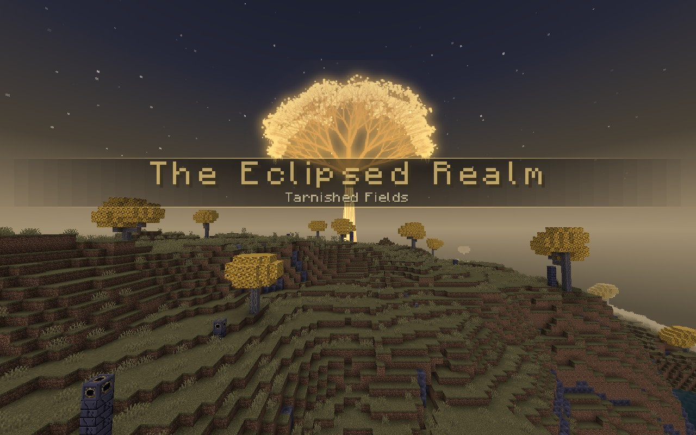

**The sun went out over an old world. What it shone on is still down there, waiting.**

Remnant Bosses opens a new dimension, the **Eclipsed Realm**, and fills it with the bosses who outlived their kingdoms. Build a Waygate, cross under the black sun, rest at Grace Embers and fight your way to each boss's arena. Every boss brings its own creature family, weapon, armor set and relic.

Built for **Minecraft 1.21.1** (NeoForge, Fabric) and **1.20.1** (Forge, Fabric).

---

## What's inside

- **A new dimension.** Seven biomes under a permanent golden dusk, from the gilded Gracewood to the calcite cliffs of the Lantern Heights.
- **Three new bosses**, each with two or three phases, a custom boss bar and music: the Hollow Sovereign, the Gravebound Warden and the Forgotten Watcher.
- **Three generated arenas**: the Hollow Citadel, the Gravebound Catacombs and the Forgotten Observatory, each sealed by a fog gate.
- **Eleven new creatures** in three families: the Hollow Legion, the Cryptborn and the Forgotten Souls.
- **Boss gear**: four signature weapons, three armor sets with set bonuses, and three off-hand relics.
- **Grace Embers**: rest to heal and set your respawn, follow the guidance of grace to the nearest arena, and fast-travel between every grace you have found.
- **Altar rituals**: summon any boss again with its offering ritual.
- **Boss Hunts journal**: tracks the bosses you have found, fought and felled.
- **Fully configurable** through JAuml: stats, damage, rituals, spawns and presentation.

---

## Entering the Realm

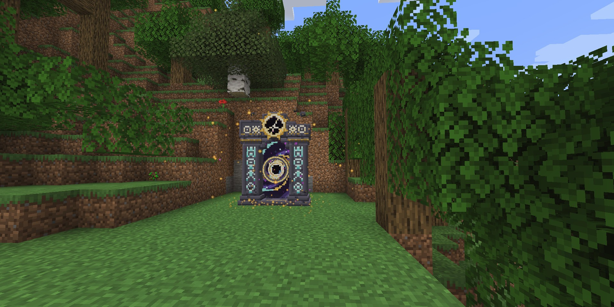

1. Craft an **Eclipse Shard**: amethyst shard + ender pearl + gold ingot (shapeless).
2. Craft a **Waygate**: polished deepslate around the edge, an Eclipse Shard top-centre, a gold ingot bottom-centre.
3. Place the Waygate. It raises a stone arch.
4. Use a second Eclipse Shard on the arch. The runes light one by one, the rings spin up, the ground shakes, and after six seconds the arch opens onto the eclipse.
5. Walk through. You arrive at an Arrival Shrine with its own open Waygate home.

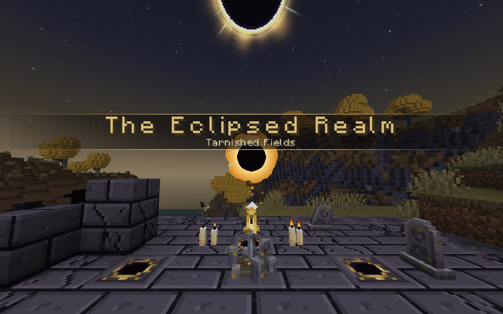

### Grace Embers

Touch the grace at the shrine. Resting at a grace:

- heals you, clears harmful effects and sets your respawn point there (beds don't work in the Realm);
- sends a trail of golden motes toward the nearest boss arena;
- opens the grace menu, where you can travel to any grace you have discovered (nearest first, with the distance in meters) or depart the Realm.

Grace shrines are scattered across every land biome, and their golden beam shows from afar. Name tags rename them.

The Realm itself does not change: outside creative mode you cannot build, break, pour buckets or blast the terrain there. Graces, Waygates, doors and chests still work.

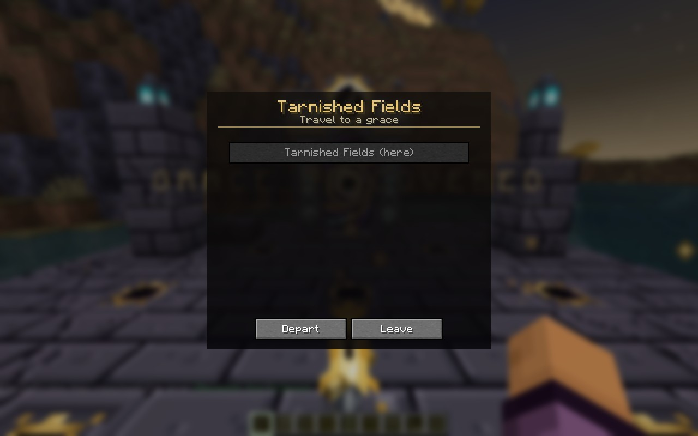

---

## The biomes

| Biome | What you'll find |
|---|---|
| **Tarnished Fields** | Pale gold grass, lone graceroot trees, broken pillars. Home of the Hollow Citadel. |
| **Gracewood** | Dense graceroot forest under a glowing gilded canopy. |
| **Gravefield Barrows** | Grey-green grass, gravestone fields, bone piles and dead trees. |
| **Ashen Wastes** | Grey ash, gravel and eclipse stone outcrops under falling ash. The Citadel stands here too. |
| **Lantern Heights** | Calcite cliffs, violet amethyst outcrops and broken sandstone stargazing pillars. Home of the Forgotten Observatory. |
| **Stilled Sea** | Dark, still water with sand and gravel shores. |
| **Ossuary Depths** | Caves of bone and cobweb beneath every land biome, where the Gravebound Catacombs lie. |

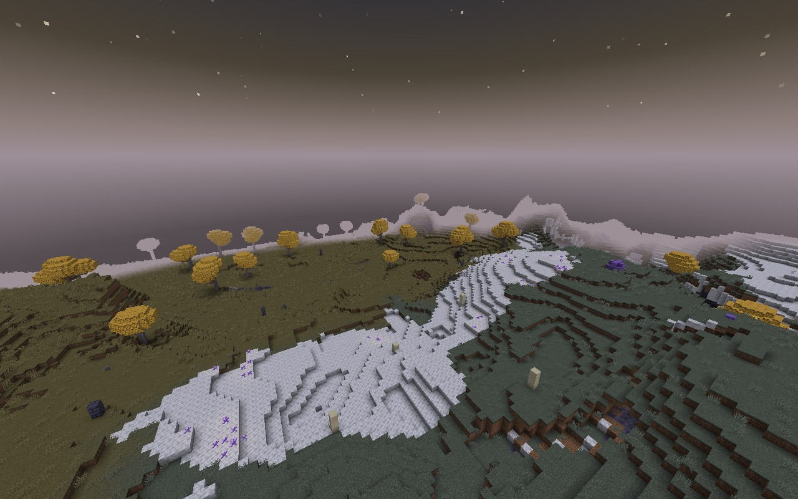
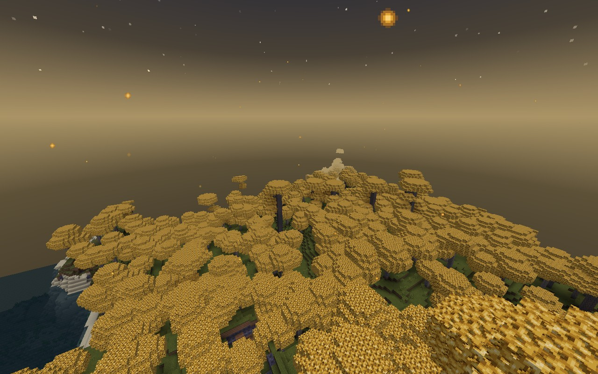
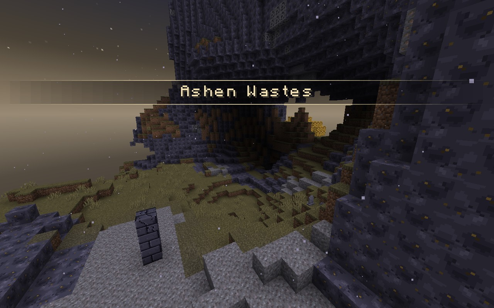

---

## The bosses

### The Hollow Sovereign: the Last King of Vael

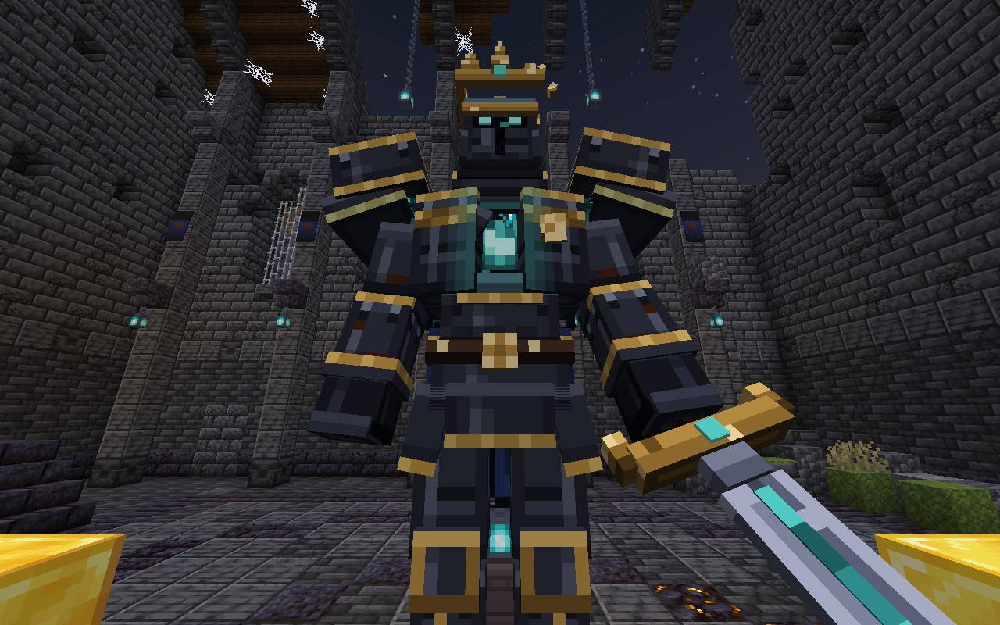

Broken royal armor with floating pauldrons, a shattered crown and a hollow chest that still holds his soul. He waits on the throne of the **Hollow Citadel**.

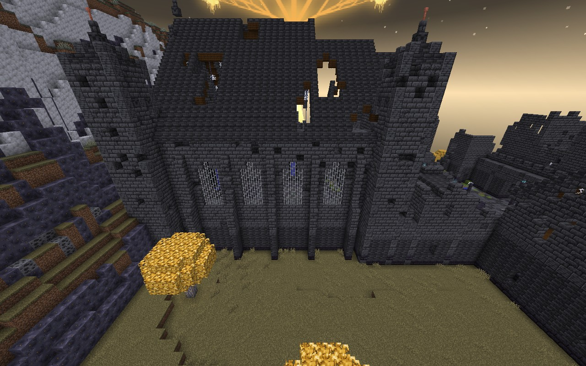

- **Phase 1, Fallen Monarch:** three-hit sword combos, a throne slam ring you jump over, a guard stance that punishes careless swings, and a ground wave you sidestep. An axe breaks his guard.
- **Phase 2, Shattered Throne:** his pauldrons tear loose and dive on their own, spectral royal guards answer his call, and he speeds up.
- **Phase 3, The Last Command:** his chest breaks open. Spectral crescents and a soul lunge join his kit, and at 10% he kneels to rain marked spectral blades across the hall.

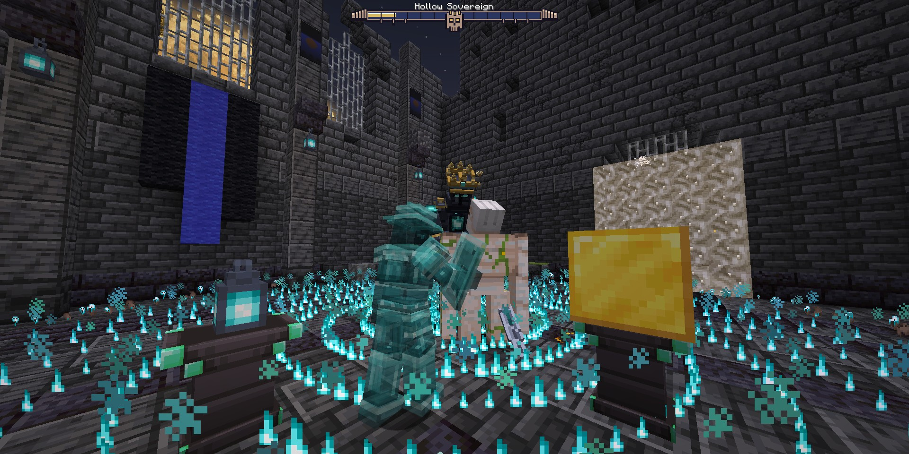

**Rewards:** Sovereign's Ruin, Sovereign's Sigil, Hollow Crown and the Regalia armor materials.

**Summon:** Sovereign's Seal (tarnished regalia, gold ingots and an echo shard) on an altar with **gold blocks** east and west and **soul lanterns** south and north.

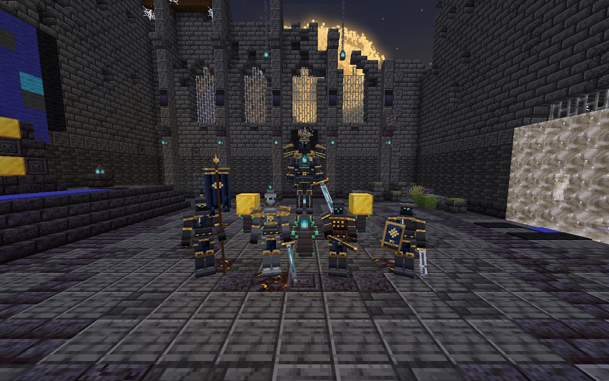

### The Gravebound Warden: Keeper of the Forgotten Dead

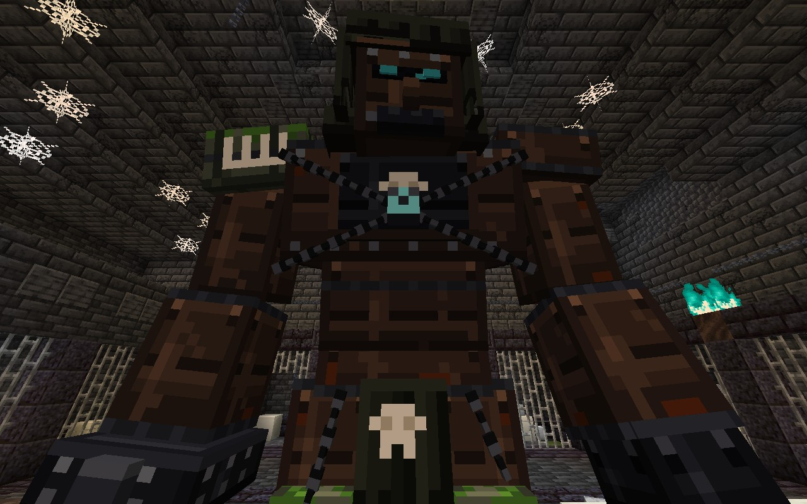

An executioner in rusted iron and chains, deep in the **Gravebound Catacombs** beneath the Realm.

- **Phase 1, The Keeper:** wide executioner sweeps, an execution chop that wedges his blade (punish it), chain grabs that drag you in, rows of grave eruptions, and Gravebound Soldiers rising from the floor.
- **Phase 2, The Open Cell:** freed souls swirl around him, he attacks faster, and chain walls split the arena into cells. Break all four anchors to stagger him.

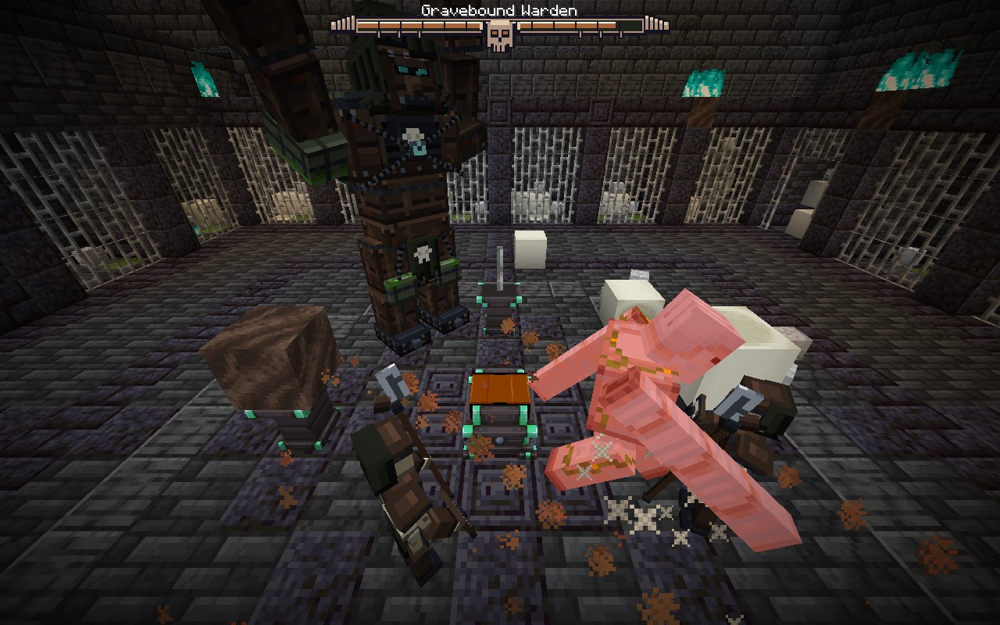

**Rewards:** Warden's Grasp, Gravebound Executioner, Crypt Sigil, grave iron and a Warden armor piece.

**Summon:** Crypt Key (grave iron around an iron block) with a **bone block** east, **soul soil** west, a **chain** south and **iron bars** north.

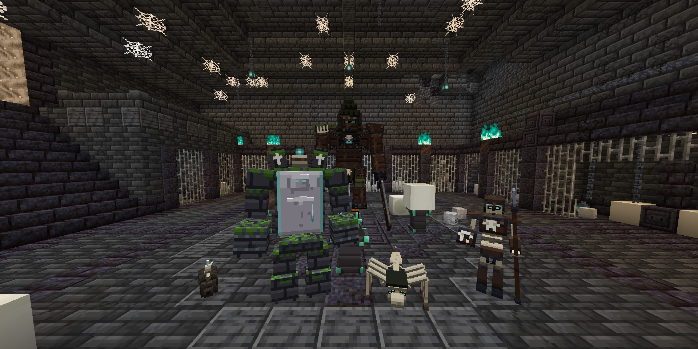

### The Forgotten Watcher: Guardian of the Last Memory

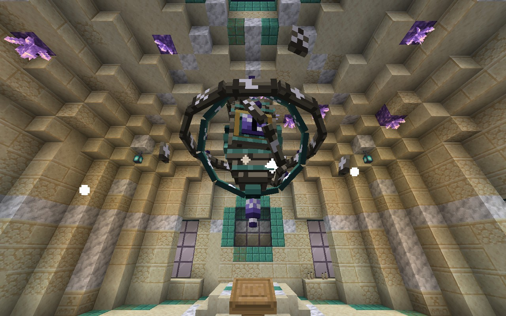

A floating sandstone obelisk inside rotating rune rings around a violet crystal eye. It keeps the dome of the **Forgotten Observatory** on the Lantern Heights.

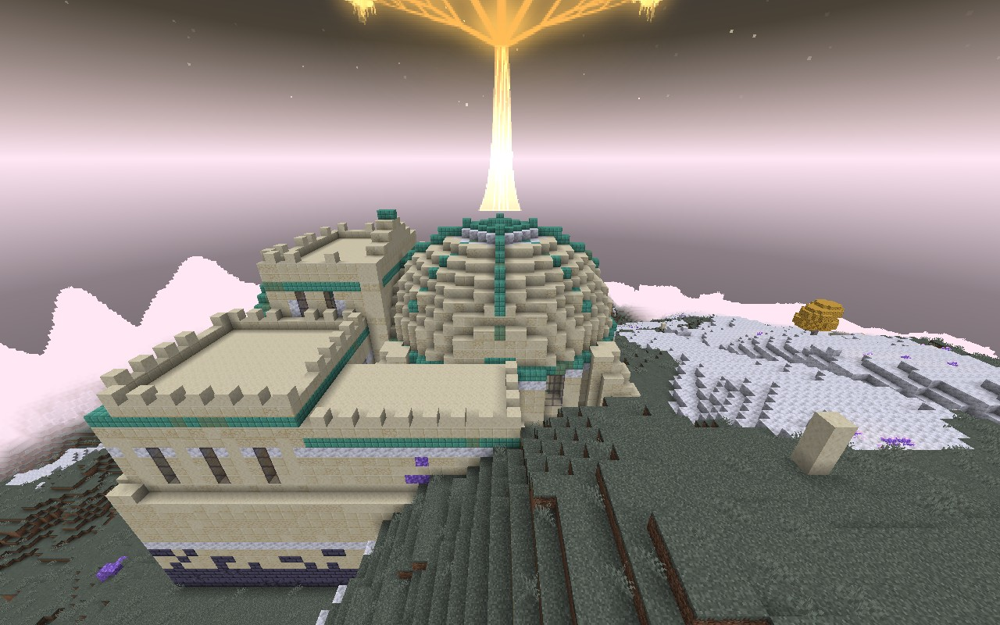

- **Phase 1:** ring-patterned volleys of memory bolts, a sweeping focused beam, and teleports between the four lens platforms around the dome.
- **Phase 2:** memory illusions (decoy Watchers that shatter when struck) and a rotating crystal aegis. Only the open segment can be hit, so circle it and strike through the gap.

**Rewards:** Memory Staff, Watcher's Eye, Ancient Knowledge Fragments and Archivist armor materials.

**Summon:** Lens of Memory (memory shards, amethyst shards and a spyglass) with an **amethyst block** east, **calcite** west, **chiseled sandstone** south and a **lectern** north. The Observatory's altar comes with its offerings already in place.

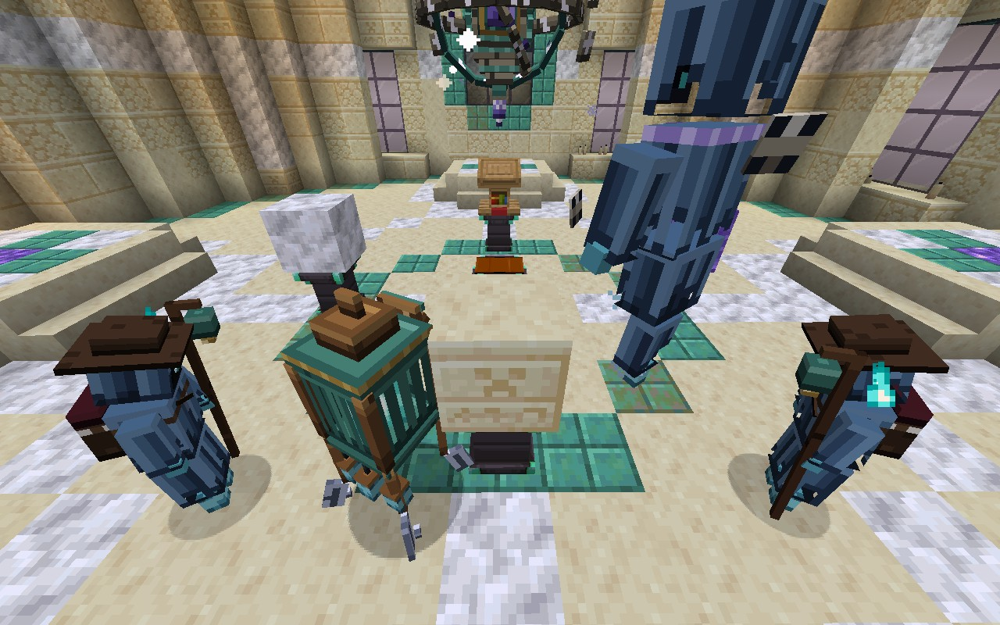

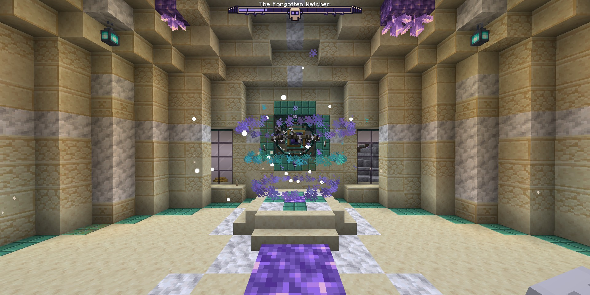

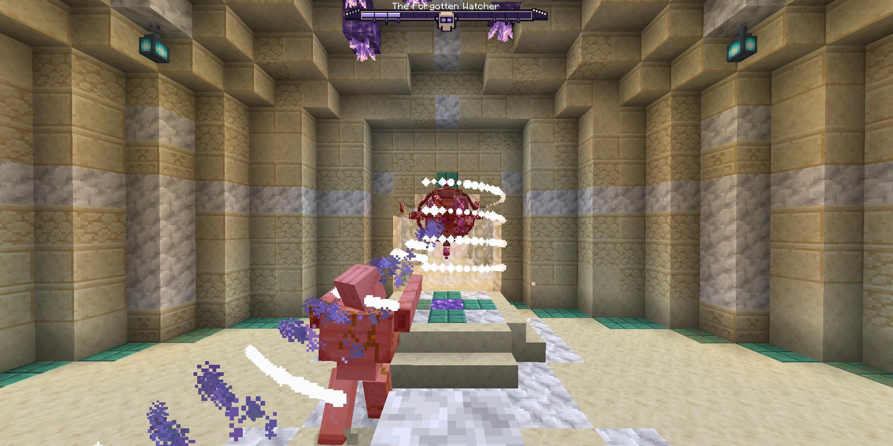

### Ossukage, the Oni Shogun

The original Remnant still answers its old ritual: a **Nether Star** on the altar with a **skeleton skull** on each pedestal. It raises Gravebound Soldiers when it arrives and drops the Ossukage Blade.

### Every kill is remembered

A felled boss is announced to everyone nearby and written into your Boss Hunts journal.

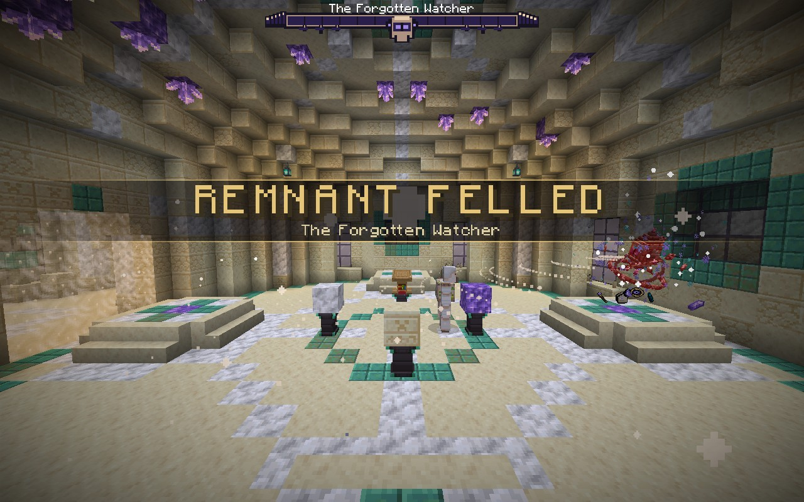

---

## Creature families

| Family | Where | Creatures |
|---|---|---|
| **Hollow Legion** | Hollow Citadel | **Hollow Sentinel** (tower shield; axes break it), **Hollow Arbalist** (crossbow, keeps its distance), **Fallen Standard Bearer** (buffs nearby Legion), **Soulbound Knight** (elite duelist with counters and lunges) |
| **Cryptborn** | Catacombs and Realm biomes | **Catacomb Rat** (swarms when one is hit, flees bright light), **Crypt Lurker** (buried ambusher), **Gravebound Soldier** (group fighter with a hooking guisarme), **Burial Guardian** (miniboss with its own boss bar, guarding the vault) |
| **Forgotten Souls** | Lantern Heights, Gracewood and the Observatory | **Lost Pilgrim** (neutral; its bell turns every pilgrim nearby against you), **Memory Wraith** (flying caster that blinks away), **Soul Collector** (elite: marks the ground, summons soul wisps and heals from every death around it) |
| **Ashbound Constructs** | Ashen Wastes, Ossuary Depths and Tarnished Fields | **Ashbound Crawler** (breathes a short flame cone; bursts in embers on death), **Ember Servitor** (hovering drone: burning bolts, welds damaged constructs), **Rusted Guardian** (slow-turning hulk: jumpable ground smash and a wide sweep) |
| **Corrupted Relics** | Gracewood, Tarnished Fields, Gravefield Barrows and Ossuary Depths | **Shardling** (floating crystals that fire in turns), **Ancient Vessel** (heavy urn: slowing pulse up close, bursts when broken), **Relic Stalker** (hidden and invisible until you come within 7 blocks, then ambushes) |

---

## Gear

| Boss | Weapon | Relic (off-hand) | Armor set bonus |
|---|---|---|---|
| Hollow Sovereign | **Sovereign's Ruin**: greatsword; charge and release to fire a piercing spectral crescent | **Sovereign's Sigil**: summon two allied spectral guards; your tamed allies nearby deal +10% damage | **Regalia**: 2 pieces add knockback resistance; 4 pieces grant Resistance after a heavy hit |
| Gravebound Warden | **Warden's Grasp**: chain hook that pulls enemies to you or you to a block. **Gravebound Executioner**: axe, +40% damage against slowed or chained targets | **Crypt Sigil**: chain the nearest enemy in place; undead deal 10% less damage to you | **Warden**: 2 pieces add +10% damage against undead; 4 pieces can chain what you hit |
| Forgotten Watcher | **Memory Staff**: tap for a homing bolt, hold for a ring burst of twelve | **Watcher's Eye**: nearby hostiles glow; use to blink 8 blocks for 2 hunger | **Archivist**: 2 pieces clear Blindness and Darkness; 4 pieces negate a projectile every 30 seconds |

Regalia and Archivist armor are crafted from their bosses' materials around the matching diamond piece. Warden armor drops directly from the Gravebound Warden.

---

## Summoning a boss

All rituals use the **Ancient Altar** and four **Ancient Pedestals**.

- **Ancient Altar:** chiseled deepslate across the top row, a diamond in the centre, emeralds in the bottom corners.
- **Ancient Pedestal:** an emerald on top, chiseled deepslate in the middle and along the bottom row.

Place the altar with a pedestal three blocks away on each side (east, west, south, north) and set the boss's offering block on top of each pedestal. Hold the summon item and right-click the altar. Shift-right-click the altar with an empty hand to open the Boss Hunts journal.

| Boss | Summon item | East | West | South | North |
|---|---|---|---|---|---|
| Hollow Sovereign | Sovereign's Seal | Gold Block | Gold Block | Soul Lantern | Soul Lantern |
| Gravebound Warden | Crypt Key | Bone Block | Soul Soil | Chain | Iron Bars |
| Forgotten Watcher | Lens of Memory | Amethyst Block | Calcite | Chiseled Sandstone | Lectern |
| Ossukage | Nether Star | Skeleton Skull | Skeleton Skull | Skeleton Skull | Skeleton Skull |

The three Realm bosses answer only inside the Eclipsed Realm by default (`rituals_realm_only` in `remnant/realm/realm`). Every summon item and offering can be changed in the config.

---

## Upgrading from 2.x

- **Kotsukage** becomes the **Gravebound Warden**, and **Umbrakar** becomes the **Forgotten Watcher**.
- The skeleton minion, grave skitter and rat become Cryptborn. The wraith and dirge lantern become Forgotten Souls.
- Old entities, spawn eggs and items in existing worlds are converted automatically. Your edited ritual configs carry over to the new bosses.
- Remnant creatures no longer spawn in the overworld. They live in the Realm.
- The Hollow Citadel and Gravebound Catacombs now generate only in the Realm, in newly generated chunks.

---

## Requirements

| Loader | Minecraft | Also install |
|---|---|---|
| NeoForge | 1.21.1 | GeckoLib, JAuml 1.2.0+ |
| Fabric | 1.21.1 | Fabric API, GeckoLib, JAuml 1.2.0+ |
| Forge | 1.20.1 | GeckoLib, JAuml 1.2.0+ |
| Fabric | 1.20.1 | Fabric API, GeckoLib, JAuml 1.2.0+ |

Install it on both the server and every client.

## Configuration

JAuml creates the config files on first launch. Under `remnant/`:

- `bosses/`: each boss's stats and attacks, and its ritual (`*_summon`).
- `monsters/`: every creature's stats.
- `realm/realm`: Waygate timings, crossing cooldown, spawn thinning, the ritual lock, guidance radius.
- `client/presentation`: area titles and camera shake.

---

## FAQ

**Do I need to travel to the Realm to fight the bosses?**

By default, yes: the Sovereign, Warden and Watcher rituals work only inside the Realm. Turn off `rituals_realm_only` to summon them anywhere.

**How do I find an arena?**

Rest at any grace and follow the golden motes. They point to the nearest arena.

**Will my 2.x world break?**

No. Old bosses, creatures and items are converted when the world loads.

**Can I use it in a modpack?**

Yes. Remnant Bosses is licensed under Apache 2.0.
